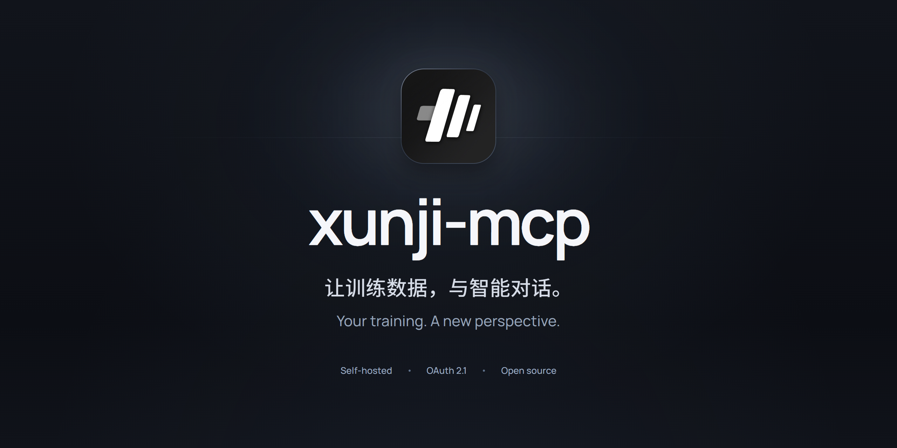
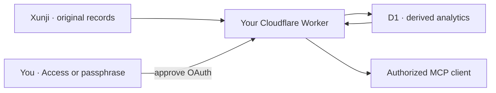

<p align="center">
  <a href="https://deliciousbuding.github.io/xunji-mcp/">
    
  </a>
</p>

# xunji-mcp

[](https://github.com/DeliciousBuding/xunji-mcp/actions/workflows/ci.yml)
[](https://deliciousbuding.github.io/xunji-mcp/)
[](https://github.com/DeliciousBuding/xunji-mcp/releases)
[](LICENSE)
[](https://modelcontextprotocol.io)

A small, self-hosted [Model Context Protocol](https://modelcontextprotocol.io) bridge that connects your [Xunji (训记)](https://xunjiapp.cn) training history to ChatGPT and other MCP clients.

Explore your training in one conversation: an overview, a movement's progress, or a grouped query over your history. The bridge runs on Cloudflare Workers with OAuth and a rebuildable D1 analytics index. Your Xunji key stays in Worker secrets; you approve client access.

**[Project site](https://deliciousbuding.github.io/xunji-mcp/)** · [简体中文](README.zh-CN.md) · [Documentation](docs/README.md) · [Get started](docs/deployment.md) · [Releases](https://github.com/DeliciousBuding/xunji-mcp/releases)

## What you can ask

| Question                                        | Tool                      |
| ----------------------------------------------- | ------------------------- |
| How has my training changed?                    | `xunji_training_overview` |
| How is one movement progressing?                | `xunji_movement_progress` |
| Compare volume by week, month, or muscle group. | `xunji_query_training`    |
| What happened on this day?                      | `xunji_get_training_day`  |
| Which dates are covered? Backfill this window.  | `xunji_history`           |
| Which tools and domains are available here?     | `xunji_capabilities`      |

The bridge also reads the movement catalog and official plans. [The tool reference](docs/tools.md) covers arguments, units, errors, and the bounded tools retained for v0.1 clients.

Results include metric definitions, coverage, and freshness. Empty days and unscanned days are separate states. Optional `MCP_UI_ENABLED=true` adds a sandboxed overview view for hosts that support MCP Apps; text remains available.

## How it works



One deployment serves one Xunji account. Xunji remains the source of truth. A Durable Object scans the history window you select, and D1 computes aggregates without sending every set to the model.

The upstream exposes daily reads with observed 15-second light / 30-second full pacing. Backfill is resumable and defaults to 100 attempted dates per UTC day. Historical reads and scans do not write the KV cache; today and yesterday use a short-lived cache with a default 300-attempt daily cache budget. OAuth storage writes are separate.

See [architecture](docs/architecture.md), [the upstream contract](docs/api-contract.md), and [privacy](PRIVACY.md) for the full data path.

## Smaller results

The synthetic benchmark compares the v0.1 per-day tool shape with an indexed overview:

| History | Per-day calls | Per-day output | Overview calls | Overview output |
| ------- | ------------: | -------------: | -------------: | --------------: |
| 1 year  |           183 |  ~43.8k tokens |              1 |     ~552 tokens |
| 3 years |           548 | ~131.4k tokens |              1 |     ~555 tokens |

The index must be backfilled first. These figures measure synthetic output and local index queries; they are not production latency measurements. [Method, limitations, and reproduction](docs/benchmark.md).

## Get started

You need Node.js 20+, a Cloudflare account, and a training Open API key from Xunji.

```bash
git clone https://github.com/DeliciousBuding/xunji-mcp.git
cd xunji-mcp
npm install
cp wrangler.example.jsonc wrangler.jsonc
npx wrangler types
npm run check
```

Then follow [the deployment guide](docs/deployment.md) to create KV and D1, configure your HTTPS origin and operator gate, and provide secrets through Wrangler's secret input. Your private `wrangler.jsonc` is gitignored.

Connect your client through OAuth at `https://your-domain.example/mcp`, call `xunji_capabilities`, and start a history backfill:

```json
{ "action": "backfill", "start": "2024-01-01" }
```

Use `xunji_history` with `action=status` to follow progress. The selected start defines the covered window; earlier days are not implied. Once indexed, ask for an overview.

[Deploy](docs/deployment.md) · [Connect ChatGPT and other clients](docs/chatgpt-connect.md) · [Tool reference](docs/tools.md)

## Access and supported scope

| Area               | Current boundary                                                                                     |
| ------------------ | ---------------------------------------------------------------------------------------------------- |
| Training reads     | Daily reads, indexed queries, PR/e1RM, movement catalog, and official plans                          |
| Authorization      | OAuth code flow with PKCE S256, exact redirects, resource audience, refresh rotation, and revocation |
| Operator gate      | Access JWT plus email allowlist, or a deployment passphrase; no identity means no grant              |
| Body and nutrition | Separate keys required; adapters remain unverified against live data                                 |
| Training writes    | Disabled by default; explicit enablement, `xunji:write`, and `confirmed: true` required              |
| Delete             | No upstream delete API                                                                               |

Xunji's training write endpoint ignores `dry_run`. The bridge never sends it; an accepted write is real. Write behavior has been tested with stubs, not through a production write.

Read [SECURITY.md](SECURITY.md), [the threat model](docs/threat-model.md), and [the coverage matrix](docs/coverage.md) before exposing your instance.

## Verification and contributing

The suite runs unit, contract, and integration tests inside workerd with stubbed upstream HTTP. CI checks types, ESLint, formatting, tests, credentials in the tree and history, runtime dependencies, and a Worker dry run.

ChatGPT OAuth connection and training reads have been verified in a private deployment. Each new deployment and client needs its own connection check. The optional MCP Apps view's registration is tested; ChatGPT rendering remains unverified. [Acceptance status](docs/acceptance.md).

[Contributing](CONTRIBUTING.md) · [Support](SUPPORT.md) · [Code of conduct](CODE_OF_CONDUCT.md) · [Changelog](CHANGELOG.md)

## License

[MIT](LICENSE). Independent project; Xunji and 训记 belong to their respective owners.
