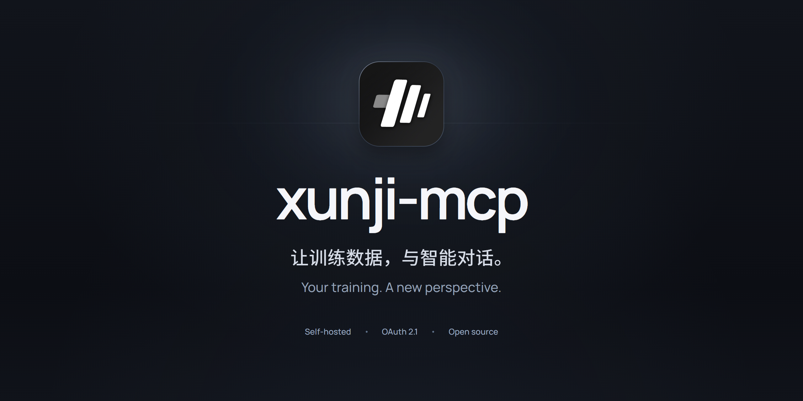
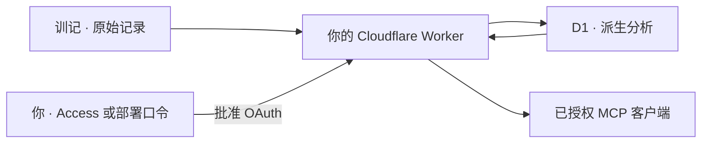

<p align="center">
  <a href="https://deliciousbuding.github.io/xunji-mcp/zh/">
    
  </a>
</p>

# xunji-mcp

[](https://github.com/DeliciousBuding/xunji-mcp/actions/workflows/ci.yml)
[](https://deliciousbuding.github.io/xunji-mcp/zh/)
[](https://github.com/DeliciousBuding/xunji-mcp/releases)
[](LICENSE)
[](https://modelcontextprotocol.io)

一个轻量、自托管的 [Model Context Protocol](https://modelcontextprotocol.io) 桥，把你的[训记](https://xunjiapp.cn)训练历史接入 ChatGPT 等 MCP 客户端。

在对话中回顾训练全貌、追踪动作进展，或按时段与肌群查询历史。服务运行在 Cloudflare Workers 上，使用 OAuth 授权和可重建的 D1 分析索引。训记 Key 保存在 Worker Secret 中，客户端访问由你批准。

**[项目主页](https://deliciousbuding.github.io/xunji-mcp/zh/)** · [English](README.md) · [文档目录](docs/README.zh-CN.md) · [开始使用](docs/deployment.zh-CN.md) · [版本说明](https://github.com/DeliciousBuding/xunji-mcp/releases)

## 可以问些什么

| 问题                           | 工具                      |
| ------------------------------ | ------------------------- |
| 我的训练有哪些变化？           | `xunji_training_overview` |
| 某个动作的进展怎么样？         | `xunji_movement_progress` |
| 按周、月或肌群比较训练容量。   | `xunji_query_training`    |
| 这一天练了什么？               | `xunji_get_training_day`  |
| 哪些日期已覆盖？回填这个时段。 | `xunji_history`           |
| 当前部署提供哪些工具和数据？   | `xunji_capabilities`      |

服务也支持读取动作库和官方计划。[工具说明](docs/tools.zh-CN.md)列出参数、单位、错误，以及为 v0.1 客户端保留的有限窗口工具。

结果明确给出指标口径、覆盖范围与新鲜度。空日和未扫描日期是不同状态。可选的 `MCP_UI_ENABLED=true` 为支持 MCP Apps 的宿主提供沙箱概览视图，同时保留文本输出。

## 工作方式



一个部署对应一个训记账号，训记保持为事实源。Durable Object 扫描你选择的历史时段，D1 直接计算聚合结果，无需把每一组记录传给模型。

上游按日读取，已观察到普通读取 15 秒、完整读取 30 秒的间隔。回填可断点继续，默认每个 UTC 日最多尝试 100 个日期。历史读取与扫描不写 KV 缓存；今天和昨天使用短期缓存，默认每天最多 300 次缓存写入尝试。OAuth 存储写入单独计算。

完整数据路径见[架构](docs/architecture.zh-CN.md)、[上游契约](docs/api-contract.zh-CN.md)与[隐私说明](PRIVACY.zh-CN.md)。

## 简洁的结果

合成基准比较 v0.1 的逐日工具形式和索引概览：

| 历史 | 逐日调用 |      逐日输出 | 概览调用 |   概览输出 |
| ---- | -------: | ------------: | -------: | ---------: |
| 1 年 |      183 |  ~43.8k token |        1 | ~552 token |
| 3 年 |      548 | ~131.4k token |        1 | ~555 token |

使用前需完成索引回填。数字来自合成输出与本地索引查询，不代表生产延迟。[方法、限制与复现](docs/benchmark.zh-CN.md)。

## 开始使用

需要 Node.js 20+、Cloudflare 账号，以及训记提供的训练 Open API Key。

```bash
git clone https://github.com/DeliciousBuding/xunji-mcp.git
cd xunji-mcp
npm install
cp wrangler.example.jsonc wrangler.jsonc
npx wrangler types
npm run check
```

然后按[部署指南](docs/deployment.zh-CN.md)创建 KV 与 D1，配置 HTTPS 域名和本人身份验证，并通过 Wrangler 的 secret 输入配置密钥。私有 `wrangler.jsonc` 已被 Git 忽略。

客户端通过 OAuth 连接 `https://your-domain.example/mcp`，调用 `xunji_capabilities` 后开始回填历史：

```json
{ "action": "backfill", "start": "2024-01-01" }
```

用 `xunji_history` 的 `action=status` 查看进度。所选起点定义覆盖范围，不暗示更早日期已扫描。索引建立后即可请求训练概览。

[部署](docs/deployment.zh-CN.md) · [接入 ChatGPT 和其他客户端](docs/chatgpt-connect.zh-CN.md) · [工具说明](docs/tools.zh-CN.md)

## 授权与支持范围

| 领域       | 当前边界                                                                  |
| ---------- | ------------------------------------------------------------------------- |
| 训练读取   | 单日读取、索引查询、PR/e1RM、动作库与官方计划                             |
| 授权协议   | OAuth 授权码、PKCE S256、精确 redirect、resource 受众、refresh 轮换与撤销 |
| 本人把关   | Access JWT 加邮箱 allowlist，或部署口令；身份未通过时不签发授权           |
| 身体与饮食 | 需要独立 Key；适配器尚未完成真实数据验证                                  |
| 训练写入   | 默认关闭；需要明确启用、`xunji:write` 和 `confirmed: true`                |
| 删除       | 上游没有删除接口                                                          |

训记训练写接口忽略 `dry_run`。本桥从不发送该字段，接受的写入就是真实写入。写行为只通过 stub 验证，没有执行生产写入。

公开部署前请阅读[安全策略](SECURITY.zh-CN.md)、[威胁模型](docs/threat-model.zh-CN.md)与[覆盖矩阵](docs/coverage.zh-CN.md)。

## 验证与参与贡献

单元、契约和集成测试运行在 workerd 中，上游 HTTP 使用 stub。CI 检查类型、ESLint、格式、测试、当前文件与历史中的凭据、运行时依赖，以及 Worker dry run。

私有部署已验证 ChatGPT OAuth 连接和训练读取。每个新部署与客户端仍需自己的接入检查。可选 MCP Apps 视图的注册已测试，ChatGPT 渲染仍未验证。[验收状态](docs/acceptance.zh-CN.md)。

[贡献指南](CONTRIBUTING.zh-CN.md) · [支持](SUPPORT.zh-CN.md) · [行为准则](CODE_OF_CONDUCT.zh-CN.md) · [更新记录](CHANGELOG.zh-CN.md)

## 许可

[MIT](LICENSE)。独立开源项目；训记及其标识归各自权利人所有。
