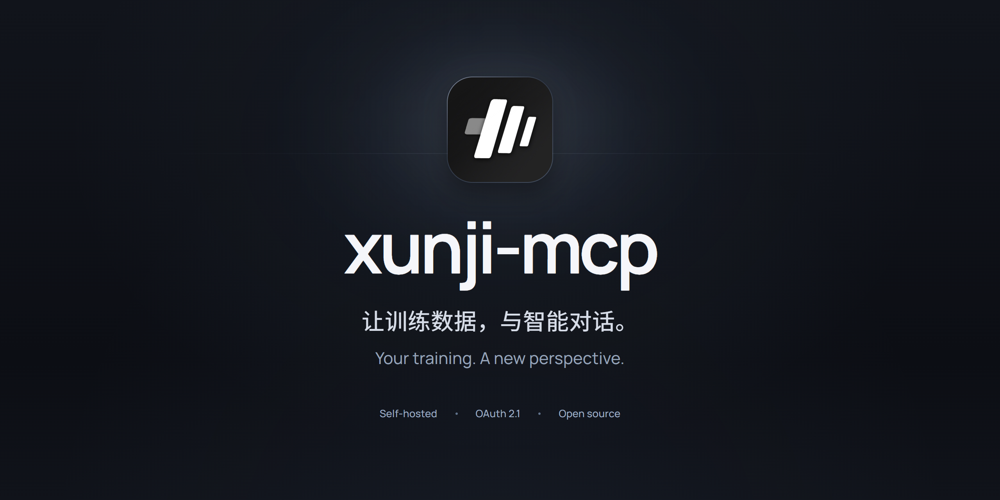

  

# v0.3.1 · A home for the project / 项目有了双语主页

[English](#english) · [简体中文](#简体中文) · [Website](https://deliciousbuding.github.io/xunji-mcp/) · [文档](https://github.com/DeliciousBuding/xunji-mcp/blob/v0.3.1/docs/README.zh-CN.md)

## English

xunji-mcp now has a bilingual project site, a complete English/Chinese documentation set, and a consistent visual identity. The core remains a small, self-hosted bridge for exploring your Xunji training history through MCP.

### What's included

- **A project site in two languages.** Separate English and 简体中文 pages, responsive layouts, synthetic training examples, keyboard-accessible tabs, setup commands, and clear documentation links.
- **Documentation that matches the current bridge.** README, architecture, tools, deployment, client connection, privacy, security, contribution, coverage, acceptance, and design decisions have matching language navigation.
- **A centered horizontal cover.** HTML/CSS, locally loaded Manrope and Noto Sans SC, and browser screenshots produce a 2560×1280 README PNG and a separate 1280×640 sharing export.
- **Release notes for every version.** Historical notes describe the behavior at each stable tag, with upgrade guidance and verification limits.

Privacy documentation now includes D1 and Durable Object state. Public acceptance pages omit personal training statistics and deployment identifiers. Body/nutrition adapters are described accurately as optional and unverified live.

`xunji_capabilities` uses the shared server version, correcting a stale v0.2.0 value. The consent page also explains persistent index storage alongside the OAuth state and read cache.

### Upgrade

The public site and documentation can be used immediately. This release does not require a database migration or new Worker secrets. Deploying the private Worker remains an operator action under the [deployment guide](https://github.com/DeliciousBuding/xunji-mcp/blob/v0.3.1/docs/deployment.md).

The MCP Apps view remains opt-in with `MCP_UI_ENABLED=true`. Training writes remain disabled by default.

### Validation and limits

The repository validation covers typecheck, lint, formatting, workerd tests with stubbed upstream HTTP, credentials scanning, and static site generation. Website demos are synthetic and never access an account. Client compatibility is checked per deployment.

ChatGPT MCP Apps rendering, live body/nutrition reads, and real training writes are not newly verified by this release. [Acceptance status](https://github.com/DeliciousBuding/xunji-mcp/blob/v0.3.1/docs/acceptance.md).

[Get started](https://github.com/DeliciousBuding/xunji-mcp/blob/v0.3.1/docs/deployment.md) · [Documentation](https://github.com/DeliciousBuding/xunji-mcp/blob/v0.3.1/docs/README.md) · [Full changes](https://github.com/DeliciousBuding/xunji-mcp/compare/v0.3.0...v0.3.1)

## 简体中文

xunji-mcp 现在有了中英双语项目主页、完整的双语文档和统一视觉。核心仍是一个轻量、自托管的桥，通过 MCP 查询自己的训记训练历史。

### 这次包含

- **中英双语主页。** 独立语言地址、响应式布局、合成训练示例、支持键盘的选项卡、配置命令与明确的文档入口。
- **与当前服务一致的文档。** README、架构、工具、部署、客户端接入、隐私、安全、贡献、覆盖、验收与设计决策都有相应语言导航。
- **居中横向封面。** HTML/CSS、本地 Manrope 与思源黑体，经浏览器截图导出 2560×1280 README PNG 与独立的 1280×640 分享图。
- **每个版本的说明。** 历史文案按稳定 tag 描述实际行为，同时说明升级方式与验证范围。

隐私文档补充 D1 与 Durable Object 状态，公开验收页移除个人训练统计与部署标识。身体与饮食适配器明确标为可选，并保留尚未真实验证的状态。

`xunji_capabilities` 同步使用统一服务版本，修正原来的 v0.2.0 固定值。授权页也补充索引持久存储说明。

### 升级

可直接使用公开主页与文档，无需数据库迁移或新增 Worker Secret。私有 Worker 的部署仍按[部署指南](https://github.com/DeliciousBuding/xunji-mcp/blob/v0.3.1/docs/deployment.zh-CN.md)由操作者执行。

MCP Apps 视图仍需明确设置 `MCP_UI_ENABLED=true`，训练写入仍默认关闭。

### 验证与限制

仓库验证覆盖 typecheck、lint、格式、使用 stub 上游的 workerd 测试、凭据扫描与静态主页生成。主页演示均为合成数据，不访问账号。客户端兼容性仍按部署验证。

本次版本没有新增 ChatGPT MCP Apps 渲染、身体/饮食真实读取或训练真实写入的验证。[验收状态](https://github.com/DeliciousBuding/xunji-mcp/blob/v0.3.1/docs/acceptance.zh-CN.md)。

[开始使用](https://github.com/DeliciousBuding/xunji-mcp/blob/v0.3.1/docs/deployment.zh-CN.md) · [文档目录](https://github.com/DeliciousBuding/xunji-mcp/blob/v0.3.1/docs/README.zh-CN.md) · [完整变更](https://github.com/DeliciousBuding/xunji-mcp/compare/v0.3.0...v0.3.1)
